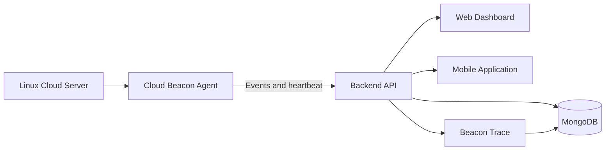

<div align="center">

# ☁️ Cloud Beacon

### A lightweight security monitoring and incident-tracing platform for Linux cloud servers

<p>
  
  
  
</p>

<p>
  <strong>Monitor.</strong> <strong>Detect.</strong> <strong>Protect.</strong> <strong>Understand.</strong>
</p>

</div>

---

## 📌 Project Overview

**Cloud Beacon** is a security system designed for small organizations, startups,
developers, and individuals who use Linux cloud servers without a dedicated
security team. A lightweight agent runs on each server, monitors important security
events, evaluates them against predefined rules, blocks suspicious activity where
possible, and securely sends evidence to a central backend.

The platform provides:

- A web dashboard for server monitoring
- Mobile notifications for security alerts
- Rule-based detection and response
- Offline event storage and later synchronization
- **Beacon Trace**, an incident timeline that explains what happened

> **Important:** Cloud Beacon uses predefined security rules. It does not use
> artificial intelligence or machine learning.

## ✨ Why Cloud Beacon?

| Challenge | Cloud Beacon response |
|---|---|
| Server owners cannot monitor their infrastructure continuously | A lightweight agent monitors servers in the background |
| System logs are difficult for non-experts to understand | Events are organized into readable alerts and incident timelines |
| Security tools can be complex to configure | Server onboarding uses a simple temporary key |
| Internet connectivity may be interrupted | The agent stores events locally and sends them later |
| Alerts alone do not explain an attack | Beacon Trace reconstructs the incident story from saved evidence |

## 🎯 Project Objectives

- Develop a lightweight agent for Linux cloud servers.
- Monitor SSH logins, system logs, port and ping scans, file changes, and permission changes.
- Detect suspicious activity using predefined rules.
- Block suspicious IP addresses where possible.
- Protect selected files from unauthorized changes.
- Build a backend and web dashboard for server, event, alert, and evidence management.
- Build a mobile application for timely administrator notifications.
- Develop Beacon Trace for evidence-based incident reconstruction.
- Simplify server setup through a temporary key without requiring a PEM key.
- Evaluate the system through simulated attacks in an authorized laboratory.

## 🔍 Security Events Covered

<table>
<tr>
<td align="center">🔐<br><strong>SSH Logins</strong></td>
<td align="center">📡<br><strong>System Logs</strong></td>
<td align="center">🔎<br><strong>Port Scans</strong></td>
<td align="center">📶<br><strong>Ping Scans</strong></td>
<td align="center">📄<br><strong>File Changes</strong></td>
<td align="center">🛡️<br><strong>Permissions</strong></td>
</tr>
</table>

## 🧩 Core Components

### 1. Cloud Beacon Agent

The agent runs on a Linux cloud server and:

- Watches defined security events.
- Evaluates activity against configured rules.
- Blocks suspicious activity where possible.
- Protects selected files.
- Sends events and heartbeat data to the backend.
- Stores data locally when the internet is unavailable.

### 2. Backend

The backend receives and manages data from connected agents. It is responsible for:

- User authentication
- Server registration and management
- Rule management
- Event and alert processing
- Evidence storage
- Communication with the dashboard and mobile application

### 3. Web Dashboard

The dashboard gives administrators a central view of their infrastructure, including:

- Connected Linux servers
- Security events
- Alerts and their severity
- Server connection status
- Incident evidence

### 4. Mobile Application

The mobile application sends notifications to administrators when suspicious
activity is detected, helping them respond even when they are away from their
computer.

### 5. Beacon Trace

Beacon Trace builds a clear incident story from collected evidence. It helps answer:

- When did the incident begin?
- What activity occurred?
- Which server or files were affected?
- What actions were taken?

## 🏗️ System Architecture



### Data Flow

```text
Security Event
      │
      ▼
Cloud Beacon Agent
      │
      ├── Rule evaluation
      ├── Blocking or protection action
      └── Local storage if offline
      │
      ▼
Backend API
      │
      ├── Event and evidence storage
      ├── Dashboard updates
      ├── Mobile notifications
      └── Beacon Trace timeline
```

## 🚀 Server Onboarding Workflow

1. The user registers and logs in to the dashboard.
2. The user selects **Add Server**.
3. Cloud Beacon generates a temporary key.
4. The user installs the agent on the Linux server and enters the key.
5. The dashboard confirms **Connection Successful**.
6. The server begins sending heartbeats, events, and evidence.

Additional servers can be added using the same workflow.

## 📋 Functional Requirements

- Users can register and log in.
- Users can add and manage Linux cloud servers.
- The agent monitors the defined security events.
- The agent sends events and heartbeat information to the backend.
- The system detects suspicious activity through rules.
- The agent can block suspicious IP addresses where possible.
- The agent can protect selected files.
- The dashboard displays servers, events, and alerts.
- The mobile application sends security notifications.
- Beacon Trace creates incident timelines from saved evidence.

## ⚙️ Non-functional Requirements

- The agent should consume minimal CPU and memory.
- Alerts should arrive within a few seconds.
- Data should be transmitted securely.
- The system should continue collecting events during internet outages.
- Offline events should be delivered after connectivity is restored.
- The interface should be understandable for non-expert users.

## 🛠️ Technology Stack

| Layer | Technology | Purpose |
|---|---|---|
| Security agent | **Go** | Small, fast, and easy-to-install Linux agent |
| Backend | **Node.js** | Backend APIs and server-side processing |
| Database | **MongoDB** | Flexible storage for events and evidence |
| Web dashboard | **React** | Interactive monitoring dashboard |
| Mobile application | **Flutter** | Android and iOS application from one codebase |
| Testing environment | **Linux + Kali Linux** | Authorized security testing laboratory |

## 🧪 Testing and Evaluation

Testing will be performed in an authorized laboratory containing a Linux server
running the agent and a Kali Linux machine acting as the attacker.

### Test Scenarios

- SSH password guessing
- Port scanning
- File modification
- Permission modification
- Agent disconnection and reconnection
- Offline event storage and later synchronization

### Evaluation Metrics

- Alert delivery time
- Agent CPU usage
- Agent memory usage
- Number of false alerts
- Blocking effectiveness
- Reliability of offline event delivery

> All security testing is intended for authorized laboratory environments only.

## 📚 Literature Review

| Tool | Main capability | Identified limitation |
|---|---|---|
| **Wazuh** | Monitors logs, file changes, and security threats; includes a dashboard and automatic responses. | Setup and management can require security knowledge. |
| **OSSEC** | Monitors logs, important files, and suspicious activities. | Requires manual configuration and lacks a modern built-in dashboard in its standard free version. |
| **Fail2ban** | Blocks IP addresses after repeated failed logins or configured failures. | Focuses mainly on IP blocking rather than complete investigation. |
| **Falco** | Detects suspicious activity on Linux servers, containers, and cloud environments. | Rules and setup can be difficult for beginners. |

Cloud Beacon builds on the useful capabilities of these tools while focusing on
simple setup, understandable alerts, mobile notifications, and incident
reconstruction for small-scale cloud users.

## 📦 Project Scope

### Included

- Linux cloud-server monitoring
- SSH, system-log, port-scan, ping-scan, file, and permission events
- Rule-based detection and response
- IP blocking where possible
- Selected-file protection
- Web dashboard
- Mobile notifications
- Beacon Trace incident timelines

### Not Included

- Windows or macOS server monitoring
- Artificial intelligence or machine learning
- Monitoring an entire network
- Replacing a complete security team

## 🗺️ Development Methodology

Cloud Beacon will follow an **Agile development methodology**. The system will be
implemented in small, testable phases, with feedback and validation performed
throughout development.

```text
Plan → Design → Develop → Test → Review → Improve
```

## ✅ Expected Outcomes

At the end of the project, Cloud Beacon is expected to deliver:

- A working Linux security agent
- A backend system with a web dashboard
- A mobile application for security alerts
- The Beacon Trace incident-analysis module
- Monitoring for defined Linux cloud-server activities
- Rule-based detection and response
- Offline event storage and synchronization
- Test results from multiple authorized attack scenarios
- A final project report and live demonstration

## 🔮 Future Direction

The current project intentionally focuses on Linux servers and rule-based detection.
Future versions may expand the platform with additional server platforms, broader
security integrations, and more advanced analysis capabilities after the core
monitoring and incident-tracing workflow has been validated.

## 👥 Academic Project Information

| Field | Details |
|---|---|
| Project | Cloud Beacon |
| Project type | Final Year Project |
| Degree | BS Computer Science |
| Department | Department of Computer Science |
| Institution | Govt. Akhtar Nawaz Khan (Shaheed) Degree College |
| Session | 2023–2027 |
| Supervisor | Dr. Abid Ali |
| Team members | Husnain Fiaz and Usman Khan |

## 📖 References

1. [Wazuh Documentation — Getting Started](https://documentation.wazuh.com/current/getting-started/index.html)
2. [OSSEC Documentation](https://www.ossec.net/docs/)
3. [Fail2ban on GitHub](https://github.com/fail2ban/fail2ban)
4. [Falco Documentation](https://falco.org/docs/)
5. [AWS Shared Responsibility Model](https://aws.amazon.com/compliance/shared-responsibility-model/)

---

<div align="center">

### Cloud Beacon

**Making Linux cloud-server security simpler, clearer, and more accessible.**

<sub>Developed as a Final Year Project • 2023–2027</sub>

</div>
